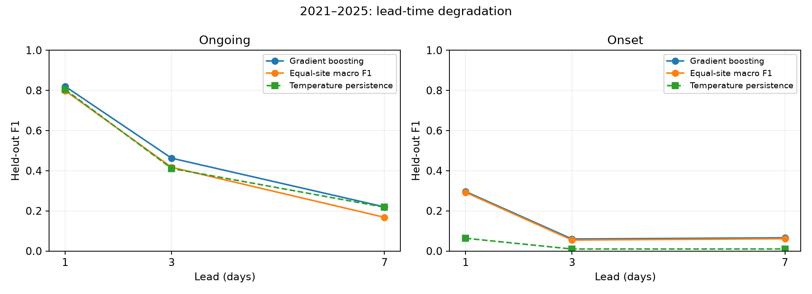
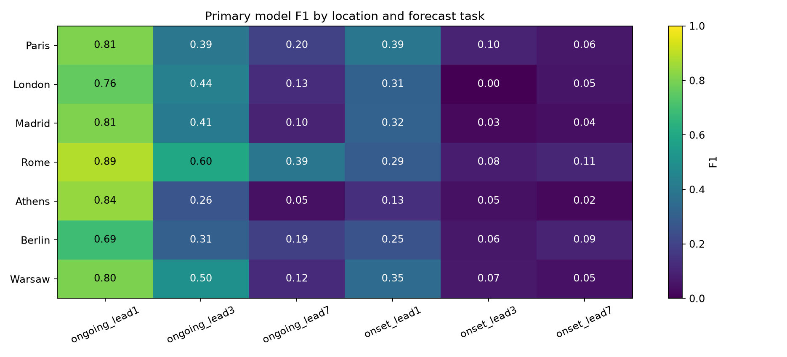
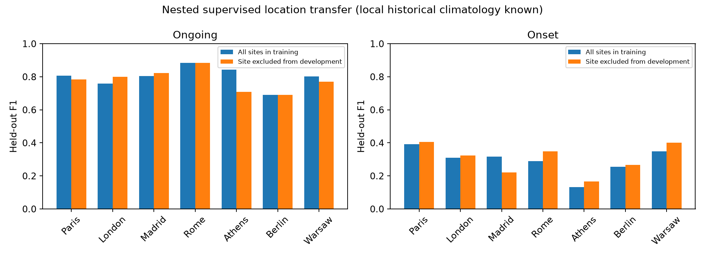

# HeatCast: Regional Robustness and Early Warning of European Heatwaves

## Abstract

We investigate how forecast lead, event definition and geography affect heatwave prediction in a reproducible multi-location ERA5 experiment. A downloaded 1981–2025 dataset covers seven representative European land grid cells and six meteorological variables. Local hot-day thresholds use the fixed 1981–2010 reference and a five-calendar-day 90th-percentile window. Ongoing-event and first-day-onset targets are evaluated at one-, three- and seven-day lead. Training ends in 2016; model selection uses 2017–2020; final evaluation covers 2021–2025. A six-candidate gradient-boosting comparison, matched one-day logistic/LSTM baselines, earlier temporal backtesting, nested location holdout, and dependence-aware uncertainty are reported. Primary one-day gradient boosting obtains ongoing F1 0.820 and onset F1 0.296. The study emphasizes regional failure detection and honest separation of sustained-event prediction from advance onset warning. Results describe a retrospective seven-location benchmark and do not establish full-European or operational real-time warning performance.

## 1. Research question and contribution

The original project asked whether recent temperature, pressure and soil moisture could predict ongoing heatwave conditions in a France-centred grid. Its corrected experiment is preserved in `results/REPORT.md`. The expanded question is: **how well do observation-only models forecast sustained hot conditions and the beginning of a new event, across locations and lead times, and where do they fail?**

The contribution is a reproducible evaluation design and implemented benchmark. Longer history addresses the unstable three-summer climate reference. Broader locations expose geographic weaknesses. Macro-site model selection gives locations equal weight. Multiple leads and an onset target test a harder warning objective than predicting an event already underway. Temporal and location holdouts test different forms of generalization. This is not a claim of a novel neural architecture or globally best prediction system.

## 2. Research basis

ERA5 provides retrospective climate fields [1]. The Open-Meteo archive offers programmatic access; its guidance recommends an explicit ERA5/ERA5-Land choice for consistent long-term studies [2]. WMO documents 30-year climate reference periods [3]. We use 1981–2010 because it precedes every development/test boundary, rather than applying a newer baseline containing future years to earlier backtests.

Percentile thresholds with calendar windows are established in climate indices [4]. Our three-day event rule is project-specific; it must not be called the six-day ETCCDI warm-spell duration index. Blocked validation addresses the temporal and spatial structure of environmental data, consistent with the issues discussed by Roberts et al. [5]. Probability verification uses discrimination, Brier score and reliability plots, drawing on the separate roles of calibration and discrimination discussed by Dimitriadis et al. [6]. We do not implement their CORP procedure and do not claim equivalent guarantees.

## 3. Data

We downloaded daily ERA5 values for 1981–2025 at Paris, London, Madrid, Rome, Athens, Berlin and Warsaw. The variables are daily maximum/minimum 2m temperature, mean sea-level pressure, mean top-layer soil moisture, mean relative humidity and precipitation sum. API requests specify `models=era5`, UTC days, land-cell selection and disabled elevation downscaling. JSON responses, actual returned grid coordinates and units, request parameters, timestamps and hashes are retained. Dates and finite values are checked before model fitting. These are reanalysis grid-cell series, not city weather-station measurements.

The spatial design is deliberately a set of contrasting European locations rather than full-grid Europe. Geographic group names are descriptive and do not establish formal climate-zone membership. The original 37 × 53 France-centred grid remains available for a separate spatial error audit.

## 4. Methods

For each site, the hot-day threshold is the 90th percentile from 1981–2010 in a centred five-calendar-day window. February 29 shares February 28's threshold while retaining its actual date in sequences. Thresholds are fixed before forecasting periods. Ongoing labels mark the third and subsequent consecutive hot days. Onset labels mark the first hot day of a run lasting at least three days after a non-hot day. Future temperatures enter onset verification only. Evaluation targets fall in May–September; context observations and verification can extend into neighbouring months.

For a target on day d and lead L, the latest observation is day d−L. Features include temperature anomalies, minimum temperature, pressure, humidity and soil moisture at predefined lags; rolling temperature and precipitation summaries; a temperature-anomaly change; fixed local thresholds; calendar harmonics; and coordinates. Temperature-only and no-soil variants form controlled predictive comparisons. No target-day or later weather enters inputs. Labels requiring future verification are embargoed at split boundaries.

Primary model development trains through 2016 and validates on 2017–2020. The final test covers 2021–2025. Each task/lead compares histogram gradient boosting with 7 or 15 leaves and three feature sets, at 160 iterations, learning rate 0.07 and L2 penalty 10. Classification cutoffs maximize pooled validation F1; candidate selection uses equal-weight macro-site validation F1. One-day logistic regression and a 14-day LSTM use matched dates/sites. The LSTM has seven inputs, 32 hidden units, training-only scaling, at most 20 epochs and validation-loss early stopping. These models are comparisons, not guarantees of neural superiority.

Temperature persistence holds the last observed maximum temperature constant for unknown days and applies the known local thresholds/event rule, retaining actual observations where available. It never lags retrospective onset labels. Climatology uses training-only seasonal event frequencies. Site-specific cutoffs are a secondary experiment, fitted from validation only with a 20-positive minimum.

An earlier one-day backtest trains through 2012, validates in 2013–2016 and tests 2017–2020. Nested leave-one-location-out experiments exclude the omitted site from supervised fitting, model selection and cutoff tuning while retaining its historical climate reference. Whole-day training resamples assess sample sensitivity. Paired seven-day blocks retain all seven locations together for 500 conditional uncertainty replicates. Because model development and test years are finite, these checks do not remove all uncertainty.

## 5. Results

| experiment | model | validation_macro_f1 | f1 | macro_site_f1 | average_precision | roc_auc | brier |
| --- | --- | --- | --- | --- | --- | --- | --- |
| ongoing_lead1 | gradient_boosting | 0.7992 | 0.8199 | 0.7988 | 0.8754 | 0.9895 | 0.0248 |
| ongoing_lead1 | logistic | 0.6919 | 0.7250 | 0.6877 | 0.7275 | 0.9743 | 0.0398 |
| ongoing_lead1 | lstm | 0.7344 | 0.7701 | 0.7431 | 0.7876 | 0.9822 | 0.0375 |
| onset_lead1 | gradient_boosting | 0.2926 | 0.2961 | 0.2921 | 0.2123 | 0.9123 | 0.0256 |
| onset_lead1 | logistic | 0.1233 | 0.1137 | 0.1144 | 0.0560 | 0.7432 | 0.0283 |
| onset_lead1 | lstm | 0.2243 | 0.2181 | 0.1955 | 0.1385 | 0.8639 | 0.0375 |
| ongoing_lead3 | gradient_boosting | 0.3852 | 0.4623 | 0.4168 | 0.4236 | 0.8888 | 0.0684 |
| onset_lead3 | gradient_boosting | 0.0989 | 0.0597 | 0.0546 | 0.0421 | 0.6083 | 0.0282 |
| ongoing_lead7 | gradient_boosting | 0.1568 | 0.2196 | 0.1678 | 0.1768 | 0.6489 | 0.0846 |
| onset_lead7 | gradient_boosting | 0.0690 | 0.0658 | 0.0613 | 0.0362 | 0.5692 | 0.0283 |

Primary gradient boosting ongoing one-day F1 is 0.820; its matched temperature-persistence F1 is 0.804. The first-day-onset model obtains F1 0.296; that task's rarity and future-duration requirement make it a different forecasting problem. Metrics must not be compared directly with the original-grid F1 0.851 because reference, sites, period and labels differ.

The three lowest ongoing one-day site F1 scores are shown below; all sites remain in pooled and macro outcomes.

| site | test_positive_days | f1 | recall | persistence_f1 | local_threshold_f1 |
| --- | --- | --- | --- | --- | --- |
| Berlin | 36 | 0.6905 | 0.8056 | 0.6538 | 0.7436 |
| London | 64 | 0.7591 | 0.8125 | 0.7799 | 0.6909 |
| Warsaw | 67 | 0.8027 | 0.8806 | 0.7719 | 0.8148 |

The original grid audit separately finds geographic differences while preserving its original test forecasts. Its fixed southwest quadrant has F1 approximately 0.805 compared with 0.871 in the southeast; all four quadrants exceed their matched persistence baseline in that experiment. These are geographic bins, not formal climate regions.

Earlier temporal backtest results:

| experiment | test | f1 | macro_f1 |
| --- | --- | --- | --- |
| ongoing_lead1 | 2017–2020 | 0.7735 | 0.7626 |
| onset_lead1 | 2017–2020 | 0.2619 | 0.2564 |

The full machine-readable regional, annual, feature-selection, transfer and training-sensitivity tables are saved in `results/research/`. Uncertainty intervals are reported in `results/research/REPORT.md` together with probability diagnostics. Negative findings at longer leads or individual sites are retained.

## 6. Discussion

The primary one-day ongoing model's paired F1-difference interval includes zero, so this expanded study does not establish a robust improvement over temperature persistence. Ongoing-event prediction benefits from observed hot-day continuity; onset warning requires correctly anticipating both the first hot day and subsequent duration. These tasks should not share a single unqualified accuracy claim. Likewise, a strong pooled score can conceal weak regions, motivating equal-site model selection and explicit local support counts.

Feature-set comparisons measure predictive usefulness under this design. They do not establish soil-moisture causality or validate an explanation of errors through climate change. Site-specific cutoffs can respond to regional base-rate differences but may overfit small validation event counts. Their test results are reported without choosing a policy after inspecting them. A longer climate reference improves threshold stability but cannot guarantee forecast skill in every location.

The transfer experiment has access to local past climatology. It tests the absence of local supervised training examples, not the absence of all local historical information. Seven sites are insufficient to claim complete regional coverage, and related locations do not form independent climate experiments. Earlier and later temporal folds overlap in development data; training resamples quantify sample sensitivity rather than new independent climates.

## 7. Limitations and next steps

- Seven representative ERA5 land grid cells; Stockholm download was incomplete under archive quota. Northern Europe is not validated; neither complete European coverage nor station observations are provided.
- Retrospective reanalysis hindcast; no operational forecast or real-time availability claim.
- The onset label uses future observations only for verification and is considerably rarer than ongoing events.
- No globally optimal model claim; candidate set is limited and final runs use one deterministic seed.
- The 1981–2010 reference is fixed for leakage-free historical tests, not the latest 1991–2020 normal.
- This is a revised retrospective benchmark after exploratory work on the original regional data; not a pristine prospective test.

A stronger subsequent study would use a denser spatial design with official geographic/land metadata, independently observed verification, nested buffered geographic blocks, longer prospective verification, and numerical-weather-forecast inputs available at issue time. An operational product would need to account for ERA5 publication delay and verify real forecast issuance rather than retrospectively available fields.

<!-- issued-forecast-extension:start -->
## Archived issued-forecast extension

An additional experiment now replays explicit archived NOAA GFS Global runs during summer 2026. Warnings are issued at 00 UTC using the previous day's 00 UTC initialization, with a 12-hour assumed publication allowance and a further 12-hour buffer. Actual warning leads are 24, 72 and 168 hours to the start of the target UTC day; initialization leads are 48, 96 and 192 hours. This conservative availability policy uses one frozen run for the complete event trajectory, without later-run or future-ERA5 input.

Early-summer development targets (May 1–June 22) define joint forecast-error scenarios and classification cutoffs. Verification required by development is allowed to become available before the June 30 freeze. All test warnings for the common July 8–September 30 target period are issued after the freeze. Incomplete archived runs cause matched-case exclusions documented in the report.

| task | raw_gfs_f1 | adjusted_f1 |
| --- | --- | --- |
| ongoing_lead1 | 0.7715 | 0.7744 |
| onset_lead1 | 0.3774 | 0.3896 |
| ongoing_lead3 | 0.7068 | 0.7132 |
| onset_lead3 | 0.3077 | 0.3409 |
| ongoing_lead7 | 0.6259 | 0.5581 |
| onset_lead7 | 0.1154 | 0.0833 |

The experiment verifies against ERA5 and records every initialization, assumed availability, issue time, target and outcome. Historical delivery timestamps are unavailable, so the replay is conditional on the publication-buffer assumption. It is not a prospective deployment. The earlier 2024–2025 ECMWF single-run archive is described by the provider as hindcasts and was excluded from this evidence. See the [full issued-forecast report](results/issued_forecasts/REPORT.md), [timing protocol](ISSUED_FORECAST_PROTOCOL.md), and [archive documentation](https://open-meteo.com/en/docs/single-runs-api).
<!-- issued-forecast-extension:end -->

## 8. Conclusion

The completed extension moves the project from a short regional experiment to a documented long-history, multi-location benchmark with explicit early-warning targets. Its value is the reproducible data acquisition, transparent selection, matched comparisons and characterization of where and when skill fails. Claims of universally higher performance or operational warning capability are not supported by this experiment.

## References

1. Hersbach et al. (2020). The ERA5 global reanalysis. https://doi.org/10.1002/qj.3803
2. Open-Meteo. Historical Weather API, fixed-model data and aggregation guidance. https://open-meteo.com/en/docs/historical-weather-api
3. WMO. Climatological Normals. https://wmo.int/wmo-climatological-normals
4. Environment and Climate Change Canada. Definitions of core climate extreme indices. https://climate-scenarios.canada.ca/?page=climdex-indices
5. Roberts et al. (2017). Cross-validation strategies for data with temporal, spatial, hierarchical, or phylogenetic structure. https://doi.org/10.1111/ecog.02881
6. Dimitriadis, Gneiting, Jordan and Vogel (2024). Evaluating probabilistic classifiers: The triptych. https://doi.org/10.1016/j.ijforecast.2023.09.007
