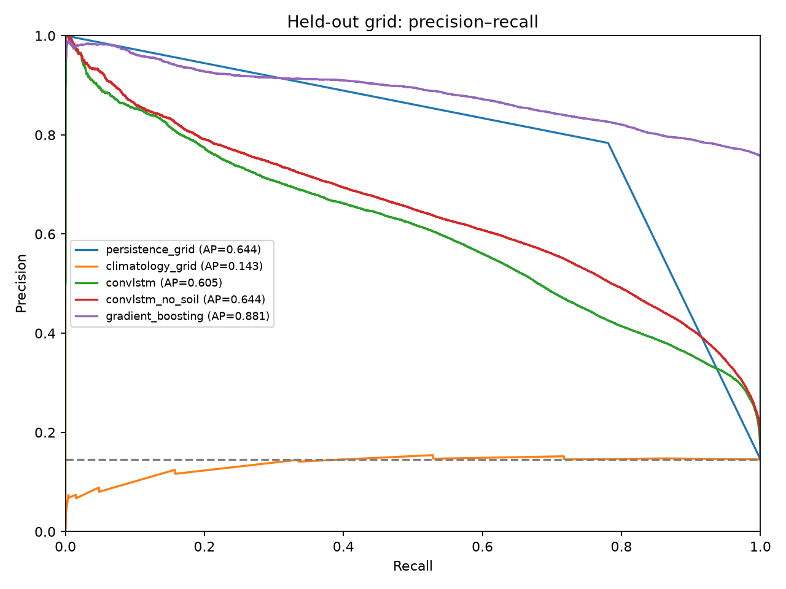
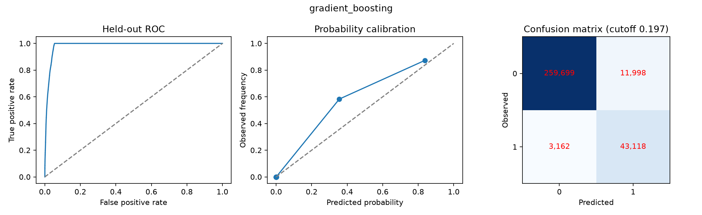
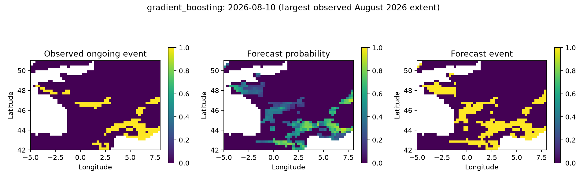

# HeatCast: Reproducible Next-Day Forecasting of Regional Heatwave Conditions

## Abstract

This project evaluates next-day forecasts of ongoing heatwave conditions in a France-centred ERA5 grid using temperature, pressure and soil moisture. Daily observations from May–August 2020–2026 are split chronologically into training (2020–2022), validation (2023–2024), and test (2025–2026). Local hot-day thresholds are estimated from training data only. Events indicate the third and subsequent consecutive days exceeding the local 90th percentile. Models include a Paris LSTM, regional ConvLSTM, a soil-moisture ablation, gradient boosting, persistence and climatology. Model checkpoints, cutoffs, boosting complexity and final model choice use validation data. Gradient boosting achieved held-out grid F1 0.850, ROC AUC 0.984, and average precision 0.881; matched persistence achieved F1 0.782. Neither neural architecture surpassed persistence in its corresponding test comparison. The results support an experimental one-day regional forecasting workflow, with limitations from the short reference period, rare validation events, spatial dependence and reanalysis availability.

## 1. Introduction

The objective is to determine whether observed recent weather can support next-day forecasts of sustained hot conditions and whether spatial recurrent learning improves on simple benchmarks. The project focuses on a defined regional experiment. It does not claim complete European coverage, operational real-time availability, or verified prediction of unprecedented events.

The original exploration contained methodological issues: thresholds included held-out years, cutoffs were selected on test labels, some windows crossed seasonal gaps, and the Paris and grid event definitions differed. The completed experiment replaces those choices with a consistent causal label and chronological selection protocol. Original metrics remain available for provenance and are superseded by the corrected evaluation.

## 2. Related work and data source

ERA5 is a global atmospheric reanalysis described by Hersbach et al. [1]. It provides the retrospective weather fields used here, through the Copernicus Climate Data Store [2]. ConvLSTM introduces convolutional recurrent transitions for spatial sequences, originally demonstrated for precipitation nowcasting by Shi et al. [3]. This study uses that architectural idea for a regional binary event task; it does not reproduce the original nowcasting experiment. Persistence and seasonal climatology provide necessary task-specific controls. Gradient boosting supplies a nonlinear tabular comparison using recent local conditions.

## 3. Methods

### 3.1 Observations and preprocessing

The local GRIB contains a 37 × 53 grid spanning 42–51°N and 5°W–8°E, at 0.25° spacing. Temperature is converted from Kelvin to Celsius and aggregated to daily maximum. Mean sea-level pressure and soil moisture are aggregated to daily means. Only days with 24 temperature observations are retained. There are 840 complete days from May 1, 2020 to August 10, 2026; the incomplete final source day is excluded.

The evaluation domain includes 1507 cells with finite training data and training mean volumetric soil moisture above 0.001 m³/m³. Near-zero ocean encodings motivated this mask. It is a land proxy rather than an official land-fraction product. Feature means and standard deviations are estimated from training data only. Excluded spatial cells are zeroed after normalization and omitted from losses and metrics.

### 3.2 Target definition

For each cell and calendar day, the 90th percentile is estimated from training temperatures within a ±15-calendar-day window. A non-leap calendar aligns the summer dates across leap years. With only three reference years, this threshold is an experimental definition, not a long-term climate normal.

A cell is labelled as an ongoing heatwave on day d when temperature exceeds its threshold on days d−2, d−1 and d. Labels therefore mark the third and subsequent hot days and never require future observations. The first two hot days are not retrospectively marked. Date gaps reset the event. All predictors use observations from d−7 through d−1; only fully contiguous eight-day spans, including the target, are evaluated.

### 3.3 Models and selection

The Paris LSTM uses a single recurrent layer with 32 hidden units and a linear output. The spatial ConvLSTM uses 12 hidden channels, 3 × 3 convolutional gates and a 1 × 1 output convolution. Its ablation removes the soil-moisture channel while preserving the domain, input duration, optimizer and seed. Neural models use AdamW, learning rate 0.001, weight decay 0.001, gradient clipping at 1, and binary cross entropy with square-root class weighting. Training runs for at most 35 epochs and stops after six epochs without validation-loss improvement. The best state is copied to prevent later optimizer updates from changing it.

Gradient boosting uses lagged temperature anomalies relative to the fixed local thresholds, pressure and soil moisture at lags 1, 2, 3, 5 and 7; recent hot-day indicators; temperature-anomaly change; and seasonal sine/cosine features. At most 250,000 training cell-days are uniformly sampled. Models with 7, 15 and 31 leaves are compared using validation F1, with 180 iterations, learning rate 0.07 and L2 penalty 10. The selected model uses 7 leaves.

Persistence carries forward the previous ongoing-event label. Climatology uses the training event frequency in a ±15-day calendar window. All learned classification cutoffs maximize validation F1; binary persistence uses 0.5. Final model selection is conducted separately within Paris and grid scopes using validation F1. The test set is not used to choose the reported winner.

### 3.4 Evaluation

Metrics include accuracy, F1, precision, recall, ROC AUC, average precision, Brier score and confusion matrices. Grid methods are compared on identical cells and dates. Paris results are a separate task and cannot establish that spatial context improves performance by comparing their scores directly. Uncertainty uses 500 paired seven-day moving-block resamples of entire spatial fields, preserving within-day spatial dependence. These intervals condition on the trained model and sampled test period.

## 4. Results

Table 1. Corrected evaluation. AP denotes average precision; all classification cutoffs use validation data.

| Model | Scope | Validation F1 | Test F1 | Test ROC AUC | Test AP |
| --- | --- | --- | --- | --- | --- |
| persistence_grid | grid | 0.584 | 0.782 | 0.872 | 0.644 |
| climatology_grid | grid | 0.036 | 0.254 | 0.498 | 0.143 |
| persistence_Paris | Paris | 0.000 | 0.848 | 0.910 | 0.744 |
| climatology_Paris | Paris | 0.017 | 0.270 | 0.463 | 0.156 |
| lstm_Paris | Paris | 0.500 | 0.550 | 0.887 | 0.556 |
| convlstm | grid | 0.364 | 0.567 | 0.898 | 0.605 |
| convlstm_no_soil | grid | 0.369 | 0.570 | 0.916 | 0.644 |
| gradient_boosting | grid | 0.739 | 0.850 | 0.984 | 0.881 |

The validation-selected grid model is gradient boosting. Its accuracy is 0.952, precision 0.782, recall 0.932, and Brier score 0.0390. Its F1 95% block-bootstrap interval is 0.773–0.902. The paired F1 difference from persistence has a 95% interval of 0.015–0.151.

The no-soil ConvLSTM slightly exceeds the full ConvLSTM on test F1 and ROC AUC in this single-seed experiment. These results do not support the original claim that soil moisture necessarily improved this architecture. Paris model choice is unstable because validation has very few positive days; the validation-selected LSTM does not beat Paris persistence on test.

Figure 1. Held-out precision–recall curves on the common grid.

Figure 2. ROC, probability calibration, and confusion matrix for the validation-selected model.

### 4.1 August 2026 case study

The largest labelled extent among available August 2026 test dates occurs on 2026-08-10. There are 163 observed event cells, 307 predicted cells and 157 intersecting cells, with IoU 0.502. This date was selected by observed extent for descriptive inspection only. A saved August 4 forecast and a next-day inference for August 11 are also exported as CSV. The latter is a forecast artifact without a complete-day verifying observation in the retained dataset.

Figure 3. Observations, forecast probability and classified event extent on the selected case-study day.

## 5. Discussion and limitations

Persistence benefits from the ongoing-event definition and temporal continuity. Gradient boosting adds information about temperature margins and recent hot-day conditions. Its high ROC AUC should be interpreted within this partly constrained next-day target: two prior hot days are required, and those observed conditions are explicitly available to the model. The result does not imply comparable skill for multi-week warnings or advance prediction of the first hot day.

The recurrent architectures did not outperform matched persistence. Possible explanations include short training history, small model search, rare validation positives and architectural or optimization limitations; this experiment cannot distinguish these explanations. The soil-moisture ablation does not establish a causal effect, and one seed cannot determine whether its small differences are robust.

Only three years define thresholds. The held-out event base rate differs markedly from validation, making cutoff transfer and model selection challenging. Spatial cell-days are dependent, and large sample counts do not imply equivalent independent evidence. The block bootstrap addresses some temporal and spatial dependence but does not capture all year-to-year or training uncertainty. The land proxy should be replaced with an official land mask for a stronger follow-up study.

ERA5 is retrospective reanalysis and is published with delay. End-of-day observations are assumed available for this hindcast; practical real-time warning would require timely observations or numerical weather forecasts. The case study does not prove that the event was unprecedented or attribute errors to climate change. No deployment or broader European generalization is demonstrated.

## 6. Conclusion

The completed project supplies a reproducible acquisition option, preprocessing, consistent causal labels, trained LSTM and ConvLSTM models, matched baselines, a soil-moisture ablation, a nonlinear comparison, held-out evaluation, uncertainty estimates and regional forecast exports. The strongest validation-selected grid model in this experiment is gradient boosting, with test F1 0.850 compared with persistence 0.782. Neural-model superiority is not supported. Future work should prioritize a longer climate reference, repeated temporal backtests, multiple seeds, an official land mask and explicit first-day-onset and longer-lead prediction tasks.

## References

1. Hersbach, H., et al. (2020). The ERA5 global reanalysis. *Quarterly Journal of the Royal Meteorological Society*, 146, 1999–2049. https://doi.org/10.1002/qj.3803
2. Copernicus Climate Change Service. ERA5 hourly data on single levels from 1940 to present. https://cds.climate.copernicus.eu/datasets/reanalysis-era5-single-levels. API setup: https://cds.climate.copernicus.eu/how-to-api
3. Shi, X., et al. (2015). Convolutional LSTM Network: A Machine Learning Approach for Precipitation Nowcasting. https://arxiv.org/abs/1506.04214
