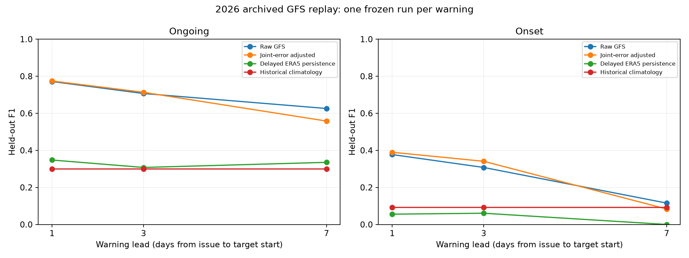
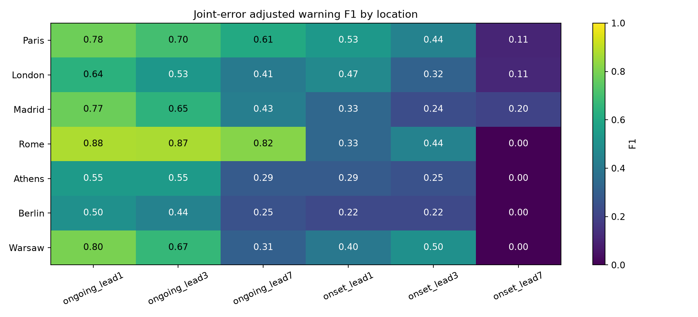
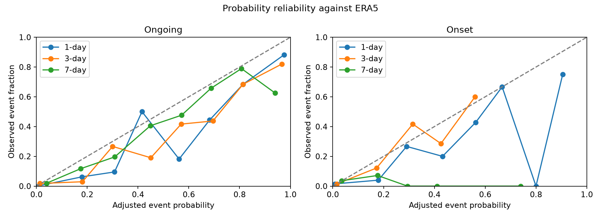

# HeatCast archived issued-forecast evaluation

## What this experiment answers

This extension tests whether heatwave warnings could be reconstructed from explicit GFS forecasts initialized before each event. It replays summer 2026 at seven ERA5 verification locations. It uses archived forecasts as predictor inputs, including complete future event trajectories, and ERA5 only for historical reference, earlier development errors, a publication-delayed baseline, and retrospective verification.

The selected run is deliberately 24 hours old at the warning decision. This makes issue timing conservative and reproducible. It does not measure the skill achievable from the freshest run. Historical API receipt timestamps are unavailable, so availability remains a stated assumption rather than an observed delivery log.

## Timing example

For a target day beginning **2026-08-01 00 UTC**:

| Warning lead | Warning issued | GFS initialization | Assumed publication by | Initialization lead to target |
| --- | --- | --- | --- | --- |
| 1 day / 24 hours | July 31, 00 UTC | July 30, 00 UTC | July 30, 12 UTC | 48 hours |
| 3 days / 72 hours | July 29, 00 UTC | July 28, 00 UTC | July 28, 12 UTC | 96 hours |
| 7 days / 168 hours | July 25, 00 UTC | July 24, 00 UTC | July 24, 12 UTC | 192 hours |

Every event day comes from that same run. No later initialization or recent, unpublished ERA5 observation fills a predictor. The archive documentation distinguishes initialization from publication and describes older ECMWF runs as hindcasts; the experiment therefore uses 2026 GFS single runs. [Provider archive documentation](https://open-meteo.com/en/docs/single-runs-api)

## Development and held-out replay

- Development targets: May 1–June 22, 2026. Onset verification ends by June 24.
- Development corrections and cutoffs freeze on June 30, after the assumed ERA5 publication delay.
- Common test targets: July 8–September 30, 2026. The first seven-day warning is issued July 1, after the freeze.
- Reference thresholds: existing fixed 1981–2010 local 90th percentiles and five-calendar-day window.
- The verification endpoint, coordinates, requests, source hashes, and every run's initialization are in `data/issued_forecasts/manifest.json` at the project root.

| period | nominal_target_days | retained_target_days | excluded_target_days |
| --- | --- | --- | --- |
| development | 53 | 50 | 3 |
| test | 85 | 85 | 0 |

Archive gaps are exclusions from all matched methods/leads, not failed forecast alerts. Their exact dates and reasons are in `metrics.json`. A missing archived response does not establish that the originating weather service failed to issue that forecast.

## Results

| experiment | method | n | prevalence | f1 | macro_site_f1 | precision | recall | average_precision | brier | false_alerts_per_100_location_days |
| --- | --- | --- | --- | --- | --- | --- | --- | --- | --- | --- |
| ongoing_lead1 | raw_gfs | 595 | 0.1765 | 0.7715 | 0.7601 | 0.6358 | 0.9810 | 0.6271 | 0.1025 | 9.9160 |
| ongoing_lead1 | joint_error_adjusted | 595 | 0.1765 | 0.7744 | 0.7020 | 0.6398 | 0.9810 | 0.8894 | 0.0475 | 9.7479 |
| ongoing_lead1 | delayed_era5_persistence | 595 | 0.1765 | 0.3478 | 0.2095 | 0.2581 | 0.5333 | 0.2200 | 0.3529 | 27.0588 |
| ongoing_lead1 | historical_climatology | 595 | 0.1765 | 0.3003 | 0.2685 | 0.1773 | 0.9810 | 0.3228 | 0.1650 | 80.3361 |
| onset_lead1 | raw_gfs | 595 | 0.0387 | 0.3774 | 0.3993 | 0.3333 | 0.4348 | 0.1668 | 0.0555 | 3.3613 |
| onset_lead1 | joint_error_adjusted | 595 | 0.0387 | 0.3896 | 0.3684 | 0.2778 | 0.6522 | 0.3722 | 0.0325 | 6.5546 |
| onset_lead1 | delayed_era5_persistence | 595 | 0.0387 | 0.0556 | 0.0317 | 0.0769 | 0.0435 | 0.0403 | 0.0571 | 2.0168 |
| onset_lead1 | historical_climatology | 595 | 0.0387 | 0.0923 | 0.0353 | 0.0714 | 0.1304 | 0.0394 | 0.0379 | 6.5546 |
| ongoing_lead3 | raw_gfs | 595 | 0.1765 | 0.7068 | 0.6779 | 0.5839 | 0.8952 | 0.5412 | 0.1311 | 11.2605 |
| ongoing_lead3 | joint_error_adjusted | 595 | 0.1765 | 0.7132 | 0.6297 | 0.5808 | 0.9238 | 0.8453 | 0.0683 | 11.7647 |
| ongoing_lead3 | delayed_era5_persistence | 595 | 0.1765 | 0.3077 | 0.1709 | 0.2273 | 0.4762 | 0.2007 | 0.3782 | 28.5714 |
| ongoing_lead3 | historical_climatology | 595 | 0.1765 | 0.3003 | 0.2685 | 0.1773 | 0.9810 | 0.3228 | 0.1650 | 80.3361 |
| onset_lead3 | raw_gfs | 595 | 0.0387 | 0.3077 | 0.3892 | 0.2759 | 0.3478 | 0.1212 | 0.0605 | 3.5294 |
| onset_lead3 | joint_error_adjusted | 595 | 0.0387 | 0.3409 | 0.3446 | 0.2308 | 0.6522 | 0.3217 | 0.0318 | 8.4034 |
| onset_lead3 | delayed_era5_persistence | 595 | 0.0387 | 0.0606 | 0.0286 | 0.1000 | 0.0435 | 0.0413 | 0.0521 | 1.5126 |
| onset_lead3 | historical_climatology | 595 | 0.0387 | 0.0923 | 0.0353 | 0.0714 | 0.1304 | 0.0394 | 0.0379 | 6.5546 |
| ongoing_lead7 | raw_gfs | 595 | 0.1765 | 0.6259 | 0.4989 | 0.5029 | 0.8286 | 0.4469 | 0.1748 | 14.4538 |
| ongoing_lead7 | joint_error_adjusted | 595 | 0.1765 | 0.5581 | 0.4437 | 0.4017 | 0.9143 | 0.5989 | 0.0982 | 24.0336 |
| ongoing_lead7 | delayed_era5_persistence | 595 | 0.1765 | 0.3352 | 0.2077 | 0.2389 | 0.5619 | 0.2115 | 0.3933 | 31.5966 |
| ongoing_lead7 | historical_climatology | 595 | 0.1765 | 0.3003 | 0.2685 | 0.1773 | 0.9810 | 0.3228 | 0.1650 | 80.3361 |
| onset_lead7 | raw_gfs | 595 | 0.0387 | 0.1154 | 0.0881 | 0.1034 | 0.1304 | 0.0471 | 0.0773 | 4.3697 |
| onset_lead7 | joint_error_adjusted | 595 | 0.0387 | 0.0833 | 0.0595 | 0.0548 | 0.1739 | 0.0632 | 0.0409 | 11.5966 |
| onset_lead7 | delayed_era5_persistence | 595 | 0.0387 | 0.0000 | 0.0000 | 0.0000 | 0.0000 | 0.0387 | 0.0521 | 1.3445 |
| onset_lead7 | historical_climatology | 595 | 0.0387 | 0.0923 | 0.0353 | 0.0714 | 0.1304 | 0.0394 | 0.0379 | 6.5546 |



`raw_gfs` applies the three-day event rule directly to the deterministic forecast trajectory. Its 0/1 output is not a calibrated probability. `joint_error_adjusted` enumerates joint ERA5-minus-GFS development error vectors at each site/task/lead. It reports the fraction of error-adjusted trajectories satisfying the event rule. A pooled cutoff is selected from development predictions excluding error vectors within seven days of each held-out development target. Test probabilities use the frozen development bank only. These scenarios are not a physical NWP ensemble.

`delayed_era5_persistence` holds the latest ERA5 daily maximum assumed published by the issue time constant. A complete day D is usable at D+6 00 UTC under this policy. `historical_climatology` uses event frequencies from 1981–2016. Both respect issue-time input availability; neither is a timely station-observation persistence benchmark.

## Event hits, misses and false alerts

| experiment | method | event_hits | missed_event_days | false_alerts | precision | recall |
| --- | --- | --- | --- | --- | --- | --- |
| ongoing_lead1 | raw_gfs | 103 | 2 | 59 | 0.6358 | 0.9810 |
| ongoing_lead1 | joint_error_adjusted | 103 | 2 | 58 | 0.6398 | 0.9810 |
| onset_lead1 | raw_gfs | 10 | 13 | 20 | 0.3333 | 0.4348 |
| onset_lead1 | joint_error_adjusted | 15 | 8 | 39 | 0.2778 | 0.6522 |
| ongoing_lead3 | raw_gfs | 94 | 11 | 67 | 0.5839 | 0.8952 |
| ongoing_lead3 | joint_error_adjusted | 97 | 8 | 70 | 0.5808 | 0.9238 |
| onset_lead3 | raw_gfs | 8 | 15 | 21 | 0.2759 | 0.3478 |
| onset_lead3 | joint_error_adjusted | 15 | 8 | 50 | 0.2308 | 0.6522 |
| ongoing_lead7 | raw_gfs | 87 | 18 | 86 | 0.5029 | 0.8286 |
| ongoing_lead7 | joint_error_adjusted | 96 | 9 | 143 | 0.4017 | 0.9143 |
| onset_lead7 | raw_gfs | 3 | 20 | 26 | 0.1034 | 0.1304 |
| onset_lead7 | joint_error_adjusted | 4 | 19 | 69 | 0.0548 | 0.1739 |

For onset, a hit means a warning for the exact first day of a three-day event, issued the stated lead before that day's start. For ongoing events, counts refer to event days and may count several days from one heatwave. `observed_event_warnings.csv` lists each observed event location-day with initialization, warning time, score, cutoff and hit/miss. `warning_audit.csv` includes all methods, negatives and false alerts. `onset_event_summary.csv` puts the 1-, 3-, and 7-day warning outcomes side by side for each observed onset.

The adjustment increases onset recall at some leads but can also increase false alerts. Its seven-day ongoing F1-difference interval lies below zero in this run, so that adjustment worsens that result. These outcomes are retained; correction is not assumed to improve every forecast.

## Regional skill



`regional_metrics.csv` retains positive counts and scores at every location, including zero-skill cases. These are seven reanalysis grid locations rather than full-European or station verification.

## Temperature errors and uncertainty

The following table averages per-site temperature MAE/RMSE in °C at the target day. The complete site metrics are in `temperature_metrics.csv`.

| experiment | raw_gfs_mae | raw_gfs_rmse |
| --- | --- | --- |
| ongoing_lead1 | 1.5867 | 1.9259 |
| ongoing_lead3 | 1.9607 | 2.4430 |
| ongoing_lead7 | 3.0133 | 3.9460 |
| onset_lead1 | 1.5867 | 1.9259 |
| onset_lead3 | 1.9607 | 2.4430 |
| onset_lead7 | 3.0133 | 3.9460 |

| experiment | adjusted_f1_low | adjusted_f1_high | difference_vs_raw_low | difference_vs_raw_high |
| --- | --- | --- | --- | --- |
| ongoing_lead1 | 0.6848 | 0.8216 | -0.0385 | 0.0487 |
| onset_lead1 | 0.2530 | 0.4943 | -0.0819 | 0.1170 |
| ongoing_lead3 | 0.6163 | 0.7670 | -0.0257 | 0.0507 |
| onset_lead3 | 0.2043 | 0.4591 | -0.0702 | 0.1324 |
| ongoing_lead7 | 0.4482 | 0.6230 | -0.1131 | -0.0297 |
| onset_lead7 | 0.0204 | 0.1667 | -0.1302 | 0.0430 |

Intervals use 500 paired seven-day moving blocks retaining whole seven-location fields. Difference intervals compare adjusted warnings with **raw GFS**. An interval crossing zero does not establish an improvement. These intervals condition on one 2026 season and the fixed development bank.



## Reproduce and inspect a warning

```bash
python -m heatcast.download_issued
python -m heatcast.issued_evaluation
python -m unittest discover -s tests -p test_issued_protocol.py -v
python tests/check_issued_artifacts.py
python -m heatcast.issued_forecast --issue 2026-07-25 --lead 7 --task onset --output results/issued_forecasts/example_warning.csv
```

Downloads cache exact requests and response hashes; incomplete runs are recorded without using later runs. Prepared daily forecast arrays are in `data/issued_forecasts/daily_runs.npz`. Each task/lead has saved predictions and an inference bundle containing only the historical threshold and development error bank. Warning inference is implemented without access to verification arrays.

## Limits

- Retrospectively retrieved explicit 2026 GFS runs, one season, seven locations; not a prospective deployment.
- Historical API receipt timestamps are unavailable; the 24-hour initialization-to-decision buffer assumes no longer publication outage.
- Model runs are 24 hours old at warning issuance, so this conservative policy does not measure freshest-run skill.
- Verification uses ERA5, not independent station observations; GFS and ERA5 grid coordinates can differ.
- Development covers early summer and test covers later summer; joint-error stationarity is an assumption.
- Empirical error scenarios are not an NWP ensemble and do not guarantee calibrated probabilities.
- Existing reanalysis-history ML scores use a different input/availability design and cannot be compared as if operational.
