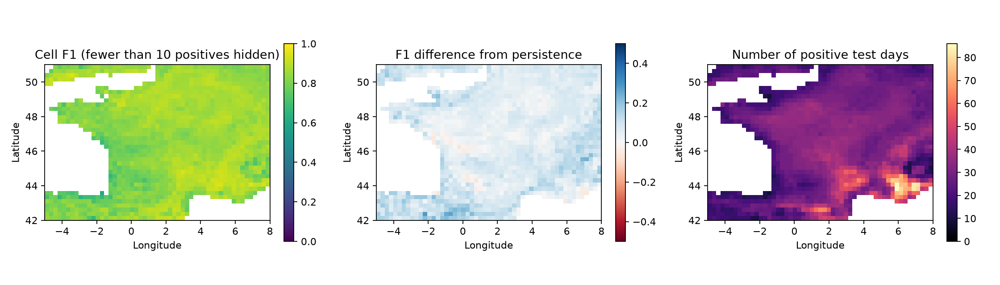

# Original-grid regional failure audit

Model: gradient_boosting; validation-selected cutoff 0.1965. No retraining or test-based cutoff changes.

1507 evaluated cells; 1505 have at least 10 positive test days. Low-support cells are identified rather than silently removed from overall scores.

## Geographic quadrants

region,n_cells,f1,recall,persistence_f1,f1_difference
south_west,298,0.8050232887211839,0.9082080617267527,0.7165569081354354,0.08846638058574852
south_east,381,0.8710966774918811,0.9325399478505048,0.798738551346999,0.07235812614488213
north_west,315,0.8386053780244651,0.9106975655430711,0.7782858482823308,0.06031952974213428
north_east,513,0.8602823890825309,0.9541344515790853,0.8006819895734286,0.05960039950910223

## Lowest F1 among cells with at least 10 positives

latitude,longitude,positive_days,f1,precision,recall,persistence_f1,f1_difference,support
43.5,-1.75,12,0.6,0.5,0.75,0.5833333333333334,0.016666666666666607,at_least_10_positive_days
43.25,-3.0,12,0.6451612903225806,0.5263157894736842,0.8333333333333334,0.5,0.14516129032258063,at_least_10_positive_days
44.5,-1.25,12,0.6666666666666666,0.5555555555555556,0.8333333333333334,0.5833333333333334,0.08333333333333326,at_least_10_positive_days
43.25,-4.25,16,0.6666666666666666,0.5652173913043478,0.8125,0.625,0.04166666666666663,at_least_10_positive_days
43.25,-1.75,11,0.6666666666666666,0.5263157894736842,0.9090909090909091,0.45454545454545453,0.2121212121212121,at_least_10_positive_days
42.0,-2.25,11,0.6666666666666666,0.5,1.0,0.45454545454545453,0.2121212121212121,at_least_10_positive_days
46.5,-1.75,18,0.6829268292682927,0.6086956521739131,0.7777777777777778,0.7222222222222222,-0.039295392953929476,at_least_10_positive_days
43.25,-2.75,14,0.6857142857142857,0.5714285714285714,0.8571428571428571,0.5,0.18571428571428572,at_least_10_positive_days
43.25,-2.5,14,0.6857142857142857,0.5714285714285714,0.8571428571428571,0.5,0.18571428571428572,at_least_10_positive_days
43.25,-2.25,14,0.6857142857142857,0.5714285714285714,0.8571428571428571,0.5,0.18571428571428572,at_least_10_positive_days

The quadrant boundaries (46.5°N and 1.5°E) are simple geographic bins, not climate or administrative regions. Test failures are descriptive findings and must not be used to tune the model on this same test set.

