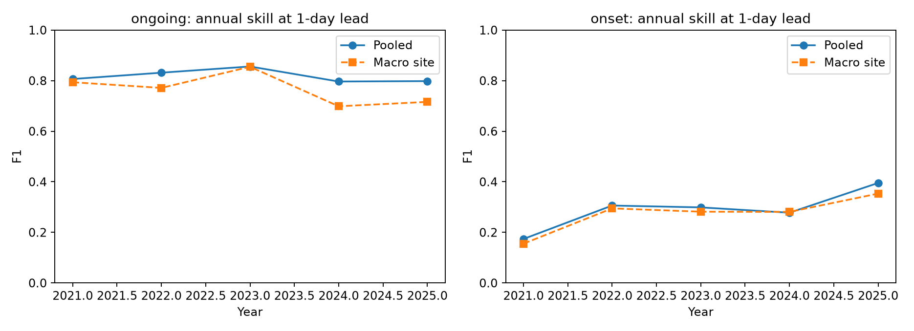
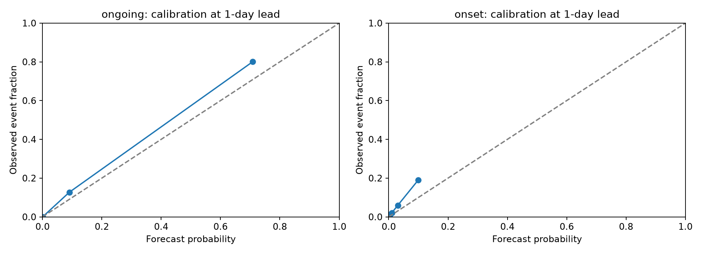

# HeatCast expanded research evaluation

Downloaded benchmark: seven ERA5 land grid-cell locations, 1981–2025. The primary final experiment trains through 2016, selects on 2017–2020, and tests 2021–2025. Hot-day reference: fixed 1981–2010, 90th percentile within a five-calendar-day window. Evaluation months: May–September.

This expansion changes the data, task definition, sites and verification period. Its scores are **not directly comparable** with the original France-grid headline score. This is a retrospective benchmark rather than a pristine prospective holdout.

## Main comparisons

| experiment | model | validation_macro_f1 | f1 | macro_site_f1 | average_precision | roc_auc | brier |
| --- | --- | --- | --- | --- | --- | --- | --- |
| ongoing_lead1 | gradient_boosting | 0.7992 | 0.8199 | 0.7988 | 0.8754 | 0.9895 | 0.0248 |
| ongoing_lead1 | logistic | 0.6919 | 0.7250 | 0.6877 | 0.7275 | 0.9743 | 0.0398 |
| ongoing_lead1 | lstm | 0.7344 | 0.7701 | 0.7431 | 0.7876 | 0.9822 | 0.0375 |
| onset_lead1 | gradient_boosting | 0.2926 | 0.2961 | 0.2921 | 0.2123 | 0.9123 | 0.0256 |
| onset_lead1 | logistic | 0.1233 | 0.1137 | 0.1144 | 0.0560 | 0.7432 | 0.0283 |
| onset_lead1 | lstm | 0.2243 | 0.2181 | 0.1955 | 0.1385 | 0.8639 | 0.0375 |
| ongoing_lead3 | gradient_boosting | 0.3852 | 0.4623 | 0.4168 | 0.4236 | 0.8888 | 0.0684 |
| onset_lead3 | gradient_boosting | 0.0989 | 0.0597 | 0.0546 | 0.0421 | 0.6083 | 0.0282 |
| ongoing_lead7 | gradient_boosting | 0.1568 | 0.2196 | 0.1678 | 0.1768 | 0.6489 | 0.0846 |
| onset_lead7 | gradient_boosting | 0.0690 | 0.0658 | 0.0613 | 0.0362 | 0.5692 | 0.0283 |

The primary model in each row is selected among six gradient-boosting candidates by validation macro-site F1, giving every location equal weight in model selection. One-day linear and LSTM comparisons use the same sites and dates. Their validation-selected champions are ongoing: **gradient_boosting**, onset: **gradient_boosting**. All test scores remain visible; no method is chosen by test rank.

## Regional weaknesses

| site | test_positive_days | f1 | recall | persistence_f1 | local_threshold_f1 |
| --- | --- | --- | --- | --- | --- |
| Berlin | 36 | 0.6905 | 0.8056 | 0.6538 | 0.7436 |
| London | 64 | 0.7591 | 0.8125 | 0.7799 | 0.6909 |
| Warsaw | 67 | 0.8027 | 0.8806 | 0.7719 | 0.8148 |

The complete table is `regional_metrics.csv`. Positive counts and validation support accompany every location. The map is a set of representative locations, not continuous continent-wide verification. Low F1 is retained in the findings rather than hidden by pooled accuracy.

## Region-specific cutoff diagnostic

| experiment | pooled_cutoff_macro_f1 | local_cutoff_macro_f1 |
| --- | --- | --- |
| ongoing_lead1 | 0.7988 | 0.7903 |
| onset_lead1 | 0.2921 | 0.2876 |
| ongoing_lead3 | 0.4168 | 0.4167 |
| onset_lead3 | 0.0546 | 0.0509 |
| ongoing_lead7 | 0.1678 | 0.1719 |
| onset_lead7 | 0.0613 | 0.0621 |

Local cutoffs use validation labels only and require 20 positives; otherwise they fall back to the pooled cutoff. They are a predeclared secondary experiment. Improvements on validation need not transfer to test, so neither cutoff policy is selected with test scores.

## Temporal robustness

| experiment | test | f1 | macro_f1 |
| --- | --- | --- | --- |
| ongoing_lead1 | 2017–2020 | 0.7735 | 0.7626 |
| onset_lead1 | 2017–2020 | 0.2619 | 0.2564 |

These temporal folds overlap in development history and are not independent replications. `training_sensitivity.csv` records whole-day training resamples with seeds 7, 21 and 42. Changing a seed alone would not meaningfully assess a deterministic tree algorithm.

## Transfer to a location excluded from model development

Each omitted location is excluded from supervised training, feature-set/complexity selection and cutoff tuning. The local historical climate reference is available. The full results are in `spatial_transfer.csv`; this does not establish transfer to a region with no historical climate information or to an unrelated continent.

## Uncertainty and probability quality

For ongoing one-day gradient boosting, F1 95% interval: [0.7890380133408342, 0.846597541854231]. Paired F1-difference interval against temperature persistence: [-0.007877160443810928, 0.036682125850031985].

The ongoing-event paired interval includes zero: the apparent advantage over temperature persistence is not conclusive under this uncertainty analysis.

For onset one-day gradient boosting, F1 95% interval: [0.2259165513150089, 0.36123498143158816]. Paired difference interval: [0.154293581446979, 0.3081466317844744].

Intervals use 500 paired seven-day blocks of whole seven-location fields and are conditional on the fitted model and available test years. Brier scores and reliability plots assess probability quality separately from classification cutoffs; they do not by themselves establish calibration.

## Reproduction and artifacts

- `python -m heatcast.download_sites` downloads the fixed data with cache/resume and rate-limit handling.
- `python -m heatcast.research` runs the predeclared benchmark.
- `python -m heatcast.research_report` regenerates tables, figures and manuscript from saved results.
- `python -m heatcast.regional_audit` diagnoses the original full grid.
- `python -m unittest discover -s tests -v` checks temporal leakage, thresholds and labels.
- `python tests/check_research_artifacts.py` audits trained-model reproduction and data provenance.

Data requests, actual returned coordinates/units and hashes: `data/europe_sites/manifest.json` in the project root. Trained estimators, LSTM checkpoints, validation/test arrays, local cutoff policies and the fixed climatology are saved beside this report. Main selection choices and test metrics are in `metrics.json`. Feature comparisons are validation results; no causal feature claim follows from them.

## Limitations

- Seven representative ERA5 land grid cells; Stockholm download was incomplete under archive quota. Northern Europe is not validated; neither complete European coverage nor station observations are provided.
- Retrospective reanalysis hindcast; no operational forecast or real-time availability claim.
- The onset label uses future observations only for verification and is considerably rarer than ongoing events.
- No globally optimal model claim; candidate set is limited and final runs use one deterministic seed.
- The 1981–2010 reference is fixed for leakage-free historical tests, not the latest 1991–2020 normal.
- This is a revised retrospective benchmark after exploratory work on the original regional data; not a pristine prospective test.
